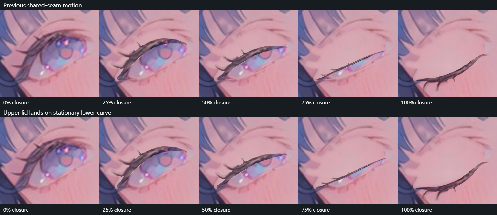
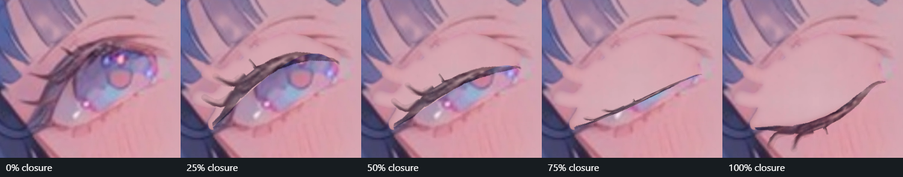
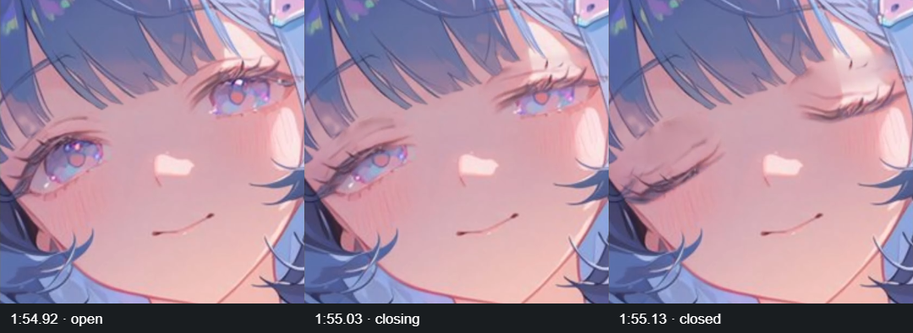

# Blink quality pass — November 9, 2026

Historical quality notes follow. The latest repair, crease and undo iteration, including both styles and current limitations, is in [BLINK_REFINEMENT.md](BLINK_REFINEMENT.md).

## Revision: upper-lid-driven closure

The default for new eyes and `blink-study.stillwave` is now **Upper lid → lower curve**. Upper closure moves the textured upper lid down; the lower curve acts as its landing target and stays fixed at the default **0% lower lid lift**. Optional lift is limited to 15% of the original aperture height. The lower source rim is preserved beneath the patch except where moving lashes overlap it. Original iris pixels remain stationary and are progressively occluded.

For source curves U/L, lift fraction k and closure c, the landing curve is `T = L − k(L − U)`, the upper boundary is `U + c(T − U)`, and the lower boundary is `L + c(T − L)`. At k=0, the lower boundary is exactly L at every pose, and at 100% the upper boundary reaches L. Upper closure and lower contribution have separate controls. The legacy shared-seam mode remains available and is the default for files lacking an explicit model; no authored seam data is discarded.

Both rows use the same original illustration, lash matte, donor, repair and roll. This sample's old seam was already close to the lower curve, so the visual difference is modest: the closed line lands lower, the lower edge no longer rises, and the partial poses feel less pinched. The tested model now guarantees that asymmetry instead of relying on a low authored shared seam. The recording remains a visual reference, not evidence of its internal algorithm. Lash thinning near 75%, heavy closed ink and approximate skin reconstruction remain visible and unresolved by this change.

Five-pose validation measures **0 px lower-boundary travel**, a final landing error below 1e-10 px, and **zero channel difference at 123 sampled lower-iris-edge pixels** in the actual 25/50/75% GPU renders. Exact 0%, unchanged source texture/alpha, localized repair and lash details are retained. Mode switching reuses the same prepared textures. The lower-lift control, undo, mode/lift save/reopen and legacy shared-seam loading are tested.

## Implemented

The former broad harmonic skin fill and synthesized lash stroke have been replaced by eye-local compositing. A source-alpha matte isolates actual lash pixels; curve-frame transport bends that texture, including individual tips. Skin repair is restricted to the original aperture and selected lashes, with a feathered cleanup margin. A chosen clean-skin source crop supplies texture, with bounded color correction rather than unrestricted interpolation from dark hair. The original crease is retained in place where it is outside the repair. Increasing the main mesh density was not the solution used here.

Manual paint/erase of the lash selection, a skin-donor rectangle, cleanup margin and lash roll are functional, undoable and saved. Five closure buttons make inspection easier. No general visual-layer system or automatic timing was implemented.

## Actual rendered results

The source is the same 500 × 560 open-eye illustration crop from 0:15 of Rui's OBS recording used by the first milestone. The fixture's lash selection was **manually refined**, and the source skin donor explicitly chosen. No PrettyUp closed-eye output or substitute/generated closed-eye image supplies these renders. The sample is saved as `blink-study.stillwave` and opens at 0%.

- **0%:** unchanged original image; no reconstruction is run.
- **25% / 50%:** original iris remains stationary behind a moving textured upper lid. The former large dark triangular wedge is absent in this refined fixture; individual lash tips move with the lid.
- **75%:** the aperture narrows cleanly, but lash foreshortening makes the lid too thin. This pose still needs work.
- **100%:** source lash details fold downward instead of becoming a synthetic line. No residual iris stripe appears in the inspected render. The original crease remains above the closed lid.

Visual comparison uses the extracted recording frames at approximately 1:54.92, 1:55.03 and 1:55.13, plus the supplied closed-eye screenshot. PrettyUp visibly retains lash tips and crease detail during closure. Stillwave now shares those observable qualities, but its closed lash is heavier, its crease is stationary rather than convincingly folding, and its late partial closure is less natural. The screenshots do not establish PrettyUp's internal algorithms. The recording's animated poses are not calibrated to Stillwave's numerical closure percentages.

## Remaining visual issues

- The repaired skin is an approximation. Faint seams and repeated mirrored donor texture can remain, particularly near corners. Hidden shading is not recovered from the flattened source.
- Automatic lash selection can include hair/iris or miss tips. This fixture requires manual refinement; an arbitrary image is not guaranteed this result by placing two corners alone.
- Roll projects a flat patch toward an edge-on orientation, so it thins around late closure and can change appearance abruptly near inversion. It is not a 3D lid model. The roll slider can reduce/disable this, but better tip/core separation or artist-authored corrective poses should precede automatic timing.
- Repair masks are not semantic protection masks. Painting a crease or overlapping hair into the lash selection will remove/move it. General occluder protection and a local clone/paint repair surface remain future work.
- Only one actual illustration has been visually tuned in this pass. Multiple eye styles and real hair-over-eye cases remain quality gates. This is an improved prototype, not production-quality blinking for arbitrary illustrations.

## Verification

`node test-blink-quality.cjs` produces the five native-size renders, comparison, editor screenshot, clean patch and lash matte/texture. Its `blink-quality-validation.json` records:

- Exact source-pixel match at 0%; immutable source texture after all five poses.
- Zero altered pixels outside the eye's expanded working rectangle, zero changed alpha, and zero changed pixels in the sampled original upper-crease area across all poses.
- Real pointer painting/erasing and undo/redo; donor rectangle selection; source image, motion masks and anchors unaffected.
- Actual project download/reopen preserves corrections; malformed raster/donor data is rejected; changing support curves invalidates prepared assets.

These numerical checks supplement visual inspection; they do not prove aesthetic quality or correctness on other artwork. `test-blink.cjs` also retains pointer placement, two-dimensional curve dragging, undo/redo, legacy projects, translucent alpha and large-source checks. The prepared patch cap is now 1024; a 2000 × 2240 test source prepared a 1024 × 981 patch in about 720 ms in one local run. Preparation is cached, but large edits can still pause the UI.

Existing `test.cjs`, `test-visibility.cjs`, `test-engine.cjs` and `test-motion-browser.cjs` pass: importing, painting, anchors, pan/zoom, save/reopen, mask visualization isolation, overlap constraints, stationary roots and local deformation behavior. Tests use the workspace's existing Playwright; the application needs no package/runtime installation or network service.

## Technical references considered

[OpenCV's classical inpainting overview](https://docs.opencv.org/4.13.0/df/d3d/tutorial_py_inpainting.html) describes nearby-pixel reconstruction. [PatchMatch](https://gfx.cs.princeton.edu/pubs/Barnes_2009_PAR/patchmatch.pdf) is a reference for exemplar-based texture reuse; [image deformation using moving least squares](https://people.engr.tamu.edu/schaefer/research/mls.pdf) is relevant to future local shape-preserving patch deformation. None of those implementations or dependencies was adopted. The bounded donor correction and curve-frame mapping here are small original prototype routines; they are not implementations of PatchMatch, MLS, ARAP, or an inferred PrettyUp method.
