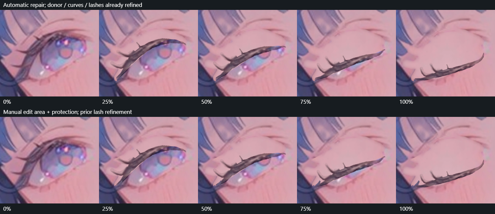
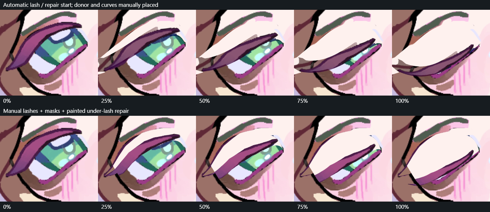
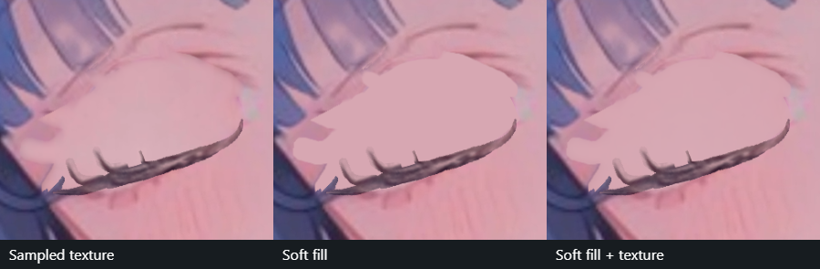

# Blink repair, curves and undo — current iteration

These are the single-eye repair-pass notes. The subsequent two-eye and shared-timing update is documented in [BLINK_TWO_EYES.md](BLINK_TWO_EYES.md); the repair tools below remain available independently for each eye.

## Try the two studies

Launch **Launch Stillwave.cmd**, then open **blink-study.stillwave** (detailed blue-haired eye) or **blink-cel-study.stillwave** (cel-shaded eye). Both start at 0%. Use the five closure buttons, and turn off Curve guides for a clean view. These are manually refined studies, not one-click automatic results.

The cel source is the unaltered open-eye frame at 6.09 seconds in the supplied 30.47-second, 674 × 592 recording. The blue source is the existing open-eye crop from the earlier OBS recording. These tests preserve those embedded source images exactly; they do not establish fidelity to unavailable original high-resolution illustration files. No generated/AI image or closed-eye replacement was used.

The blue study uses sampled texture and its previously refined lash matte. The first row has automatic repair bounds; the second adds a manually specified edit area and hair protection. Thus the first row is **not automatic lash isolation**. At the gentler roll setting, lashes remain wider at late closure. Small corner/edge artifacts and reconstructed shading remain imperfect.

For the cel study, the first row uses automatic lash isolation with manually placed curves and skin donor. The second uses a traced lash matte, edit boundary, protection and a small brown under-lash paint correction where hidden hair must be approximated. The correction is hand-authored fixture data, not inferred hair reconstruction. It removes the conspicuous skin-colored wedge into hair, but its junction with the face is still a visible artistic compromise. The bold upper lash and lower rim can form a heavy doubled line at full closure. Neither study is declared universally production-ready.

## Repair controls

Under **Skin repair & protection**, choose a paint target, then **Paint selected target** or **Erase selected target**:

| Target | Job |
| --- | --- |
| Original lashes | Isolate actual source pixels that deform with the upper lid. Exclude iris, hair and crease. |
| Blink edit area | Hard outer limit for every blink change, including lashes and crease. Erase outside it, or Clear blink target and paint the allowed area from scratch. |
| Protected artwork | Keeps original hair, linework or other artwork unchanged. Protection overrides the blink and touch-ups. The overlay is hatched. |
| Skin touch-up | Paint a small correction behind the moving lashes. Eraser reveals the reconstruction beneath it. |

Painting masks shows the open source. Skin touch-up painting shows full closure; **Pick touch-up color** temporarily shows the original and samples a clicked source pixel anywhere in the image. The default paint color is the skin donor's median. **Clear blink target** empties the selected target; **Reset selected target** removes its manual override (automatic lash selection, unrestricted working area, empty protection or empty touch-up). All are undoable.

Keep the whole eye opening inside the edit area and unprotected. Deliberately protecting iris pixels or excluding them from the area will keep them visible even at full closure. Inward Boundary feather softens the edit-area edge without expanding it. It does not blur source iris/white into the skin. At 0%, the blink pass is bypassed regardless of masks or touch-ups. Regular body/hair motion still runs independently.

| Reconstruction | Appropriate use | Limitation |
| --- | --- | --- |
| Sampled texture | Detailed shading; retains the existing native-scale mirrored donor and bounded color correction. | Repetition or repair seams can remain. |
| Soft color fill | Flat cel skin; uses the median of the chosen clean-skin donor. | Can erase nuanced shading and make a flat patch on detailed artwork. |
| Soft fill + donor texture | Reduces donor texture variation while keeping some texture/color correction. | Still unsuitable for some complex shading. |

No full inpainting library or generative model was added. Classical local filling and gradient-domain blending were considered: [OpenCV photo operations](https://docs.opencv.org/4.12.0/dc/d81/photo_8hpp.html), [Pérez et al., Poisson Image Editing](https://www.cs.cornell.edu/courses/cs5670/2020sp/resources/Perez_PoissonImageEditing.pdf). A general neighborhood fill could import iris, white or dark hair into the skin; this iteration uses explicitly selected clean skin plus masks and paint. A color-threshold protection experiment left dotted lash ghosts and was removed. The blend option is not a Poisson or Telea implementation.

## Curve and workflow changes

- Upper lash, lower landing boundary and crease have independent curve controls. A new round midpoint handle changes the curve's bulge while retaining its corners and existing Bézier handles. It is a real deformation control, not just a guide.
- Select **Eyelid crease** to trace the painted crease. **Crease movement** moves a narrow strip subtly with upper-lid travel. The strip's outer edges stay fixed, its source is restricted above the lash line, and it respects edit/protection masks. This is local image resampling, not a whole-eye squash or a synthetic crease stroke.
- The lower lid still defaults to stationary. Upper-led and legacy shared-seam modes remain available.
- **Lash roll** is now inside Advanced blink settings. New eyes default to **50% strength**, using a gentler nonlinear mapping to the existing angle parameter (40°). The full old angle range remains available. Existing saved angles, including old defaults, are not changed. The old edge-on inversion remains possible at high settings.
- Click a handle, then use arrows to nudge by one source pixel, Shift+arrows for five. Nearby handles select by nearest distance, avoiding accidental selection of another handle within the hit radius.

## Undo, compatibility and testing

Ctrl+Z now reaches app history when focus remains on a curve dropdown, range or canvas. Ctrl+Shift+Z and Ctrl+Y redo. Text fields retain native text undo. A completed handle drag or brush stroke commits one history entry; canceled/no-op drags add none. Parameters group their pointer/key edit into one transaction. History includes masks, paint, crease, methods and settings; eye-raster memory is included in the history limit. Curve editing stays in its eye view after undo.

Project version remains 1. New optional fields are `repairMode`, `repairFeather`, `repairLimit`, `protectMask`, `repairPaint`, `repairColor`, `crease`, `creaseMove`, `creaseBand` and `bends`. Masks are bounded source-coordinate alpha records; touch-up is a bounded RGBA record. Data and references are validated before replacing a project. Old eyes keep their texture reconstruction, stationary crease, original roll and authored motion unless edited. The source image and motion/anchor masks are never painted over. No visual-layer system was implemented.

`test-blink-refinement.cjs` renders both styles at 0/25/50/75/100%, plus all three methods and crease on/off. It checks exact 0%, unchanged alpha, zero changes to protected/outside-area pixels, replacement of sampled original iris colors, real crease-pixel movement, keyboard undo from dropdown/range focus, one-action drags/strokes for all four paint targets, cancel behavior, color picking, clearing and save/reopen. Existing editor, visibility, engine, motion, blink and previous-quality suites also pass. The iris-color test is a sampled regression check, not a proof that every arbitrary eye will close perfectly; the actual images above were inspected separately.

Remaining work: refine corner transport and matte edges, improve crease deformation on more styles, support painted hidden shading more naturally, and reduce patch preparation pauses for large images. Protection and a tight edit boundary necessarily clip moving lashes if painted across their destination. Automatic timing, a second eye and general layers remain deferred.

The preview cache now keys raster records without serializing their multi-megabyte contents on every frame. A two-second local headless Chrome check of the cel study at 50% measured about 75 fps, with zero repeated raster preparations. This is a cached-preview measurement on this machine, not a promise for live curve dragging, all hardware or large illustrations.
