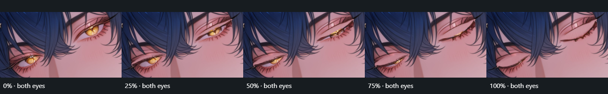
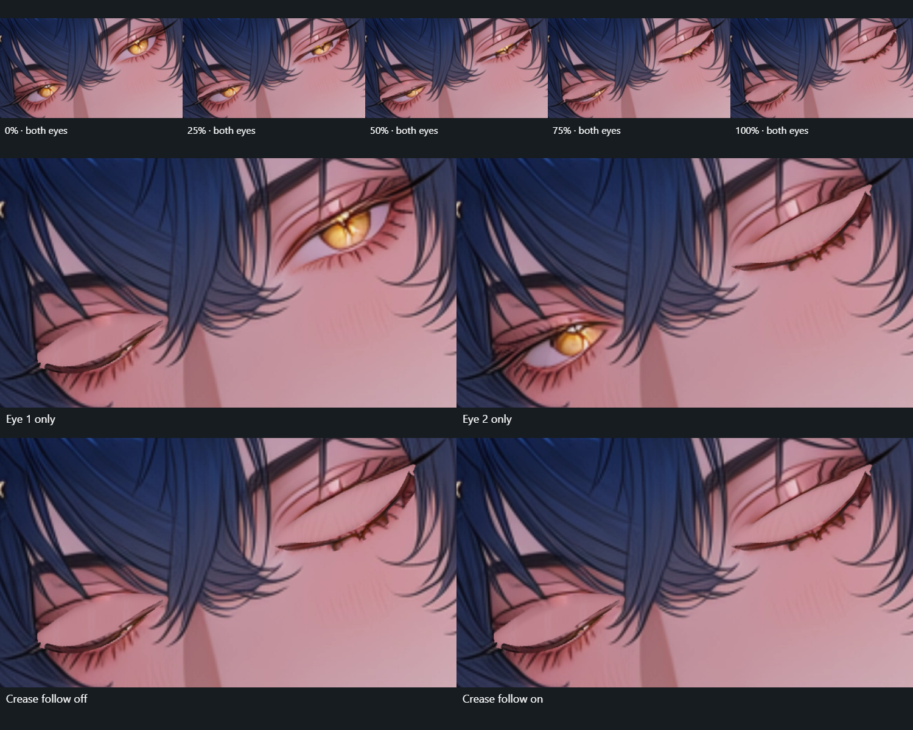

# Two eyes and crease follow — November 10, 2026

## Try it

Launch **Launch Stillwave.cmd**, open **blink-two-eye-study.stillwave**, then press **Play**. The two asymmetrical golden eyes use one clock with independently traced shapes, lash mattes, repair donors and protection masks. Pause freezes the current blink; Reset returns an animated preview to open. The 0/25/50/75/100% buttons return to manual preview.

To add another eye to your own single-eye project:

1. Click **Add second eye**, then drag between that eye's own corners. Its geometry and masks start fresh; nothing is copied or mirrored.
2. Use **Edit eye** to switch between Eye 1 and Eye 2. Existing curve, lash, reconstruction, touch-up and protection tools affect only the selected eye. **Replace eye** replaces that definition; **Remove selected eye** removes it. Both operations support undo.
3. Choose **Preview → Both eyes** to preview linked closure amounts. Choose **Selected eye only** to inspect an individual eye at any closure or during playback. This is a display filter, not deletion or a permanent visibility change.
4. Open **Shared blink timing** to enable/disable automatic blinking and adjust **Blink length** and **Interval**. Play advances the shared clock; pause freezes it. Blink length includes a short closed hold, with eased closing and reopening. Interval is measured between blink starts.

Automatic blinking is enabled when placing the first eye or adding the second eye. Older single-eye files retain manual playback unless you enable it. Both-eye manual closure changes both stored closure amounts; selected-only preview changes only the selected eye. The renderer can therefore retain separate manual poses, while automatic playback currently uses one shared closure envelope. Independent clocks/phase offsets remain future work.

## Crease follow

Trace the independently editable **Eyelid crease** curve, then adjust **Crease follow**. New eyes retain the subtle 8% default; the manually refined study uses 14% and 16%. The control now permits up to 40% for styles needing more movement.

The old crease strip limited travel to a fraction of its fixed width, often only a few pixels. Its lower influence area now grows downward with the crease. A monotone cubic inverse warp carries the original painted detail with smooth falloff. The ceiling above the crease stays fixed; no crease-driven pixels above it move. The underlying repaired skin is sampled rather than squashing the whole eye or blurring the visible iris into the face. The upper lash remains the primary moving boundary, with a stationary lower lid by default.

**Advanced → Crease reach above line** controls how far above the crease the effect can extend. Keep this below the eyebrow and protect brow/hair details when needed. There is no automatic semantic eyebrow detection: a badly placed crease or excessive reach can include artwork you intended to leave alone. Source and destination protection are respected. Very strong follow can still stretch local shading; start small.

## Actual results and remaining issues

The illustration is an unchanged open-eye frame at 6.59 seconds from the supplied 32.97-second, 950 × 612 recording. These are **manually traced and refined** results: independent curves, lash selections, donors, edit boundaries and hair/brow protection. No second-eye mirroring, generated imagery or substituted closed-eye artwork was used.

Both irises disappear in the inspected full-closure render. The recorded preview closes/reopens both eyes together. Original lash details and lower lashes remain visible. After replacing a poor donor on the smaller eye, the obvious striped repair was removed. Small corner seams, imperfect reconstructed shading and some hard lash-edge pixels remain. This pass preserves the existing repair approach; it does not recover genuinely hidden eyelid painting.

The live recording is `test-output/two-eye-animation.webm`; its test interval is shortened to 1.2 seconds to show several cycles. `two-eye-animation-frames.png` contains decoded frames from that actual recording. The saved study uses a 2.4-second interval; the default for new documents is 3 seconds.

## Renderer, compatibility and validation

The existing single-eye patch renderer remains the unit of deformation. Each eye prepares its own source-derived textures, then a combine pass selects the changed pixels from each result. Expanded preparation rectangles can overlap without unchanged pixels from the second eye erasing the first. If both eyes actually change the same pixel, Eye 2 wins; keep edit areas distinct for unusual overlapping setups. Protection is scoped to its owning eye. The main connected mesh, anchors and motion solver are unchanged. At 0% for both eyes, the source texture is returned directly.

Projects remain version 1. The existing `eyes` array now permits zero, one or two complete definitions. Optional document-level `blinkTiming` stores enabled/duration/interval/hold. Missing timing defaults to disabled, so older single-eye files retain their behavior and data. Invalid eyes/timing are rejected before replacing the current project. Older builds that only support one eye cannot open a new two-eye file. History stores both definitions and restores the eye being edited; a completed drag/stroke is still one action.

`node test-two-eyes.cjs` checks both eyes and each selected-eye preview at 0/25/50/75/100%, live shared animation, pause/reset, independent edits/masks, add/remove undo, download/reopen, old files and third-eye rejection. The recorded run has exact 0%, unchanged alpha, no changed protected/outside-area pixels, no combine mismatch against the two individual results, and no remaining golden iris color among 1,568 sampled iris pixels. Crease follow changes 2,224 pixels near Eye 1 and 4,069 near Eye 2, with zero changes above their fixed ceilings. These counts supplement visual inspection; they do not certify every possible illustration or mask.

All seven earlier regression suites also pass, including the detailed and cel-shaded single-eye studies. Two full-size eye outputs plus a combined texture increase GPU memory use; cached assets are reused, but larger source images can still pause during preparation. No full visual-layer system or general animation export UI was added.
