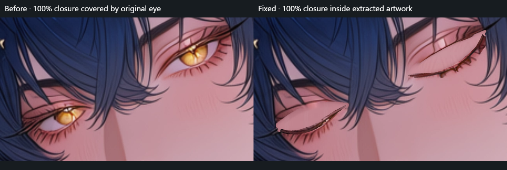
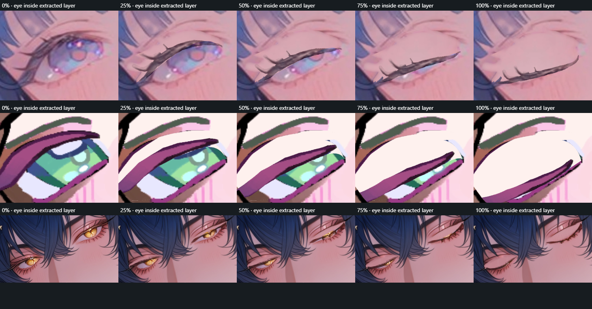

# Eye tools fix — extracted artwork covering the blink

Rui's 2026-11-10 22:44:57 recording shows the closure slider and magenta lash overlay moving while the actual eye stays open. A small skin/lash fragment appears beyond the right edge. The extracted “Hair” layer remains visible at 100% opacity above the eye edit.

## Reproduced cause

An extracted artwork layer can include the face or eye as well as hair. Its label does not restrict which pixels it contains. Stillwave previously applied blinking to the **base/backing composite**, then drew the extracted layer using its unchanged original texture. If that layer contained the eye, it covered the blink with an open-eye copy. Mask overlays were drawn afterward, which made them appear to work independently of the visible artwork.

The reproduction used an extracted face containing both eyes. Before the fix, the rendered 100% closure image was **identical to the 0% image**. This is the missing overlap case in the earlier tests; those used small hair patches that did not cover the eye opening.

## Fix

- Prepare lashes, skin and protection from the immutable original illustration, rather than a source image already cut apart and underpainted.
- Render the existing blink once in original-image coordinates.
- Apply those changed pixels to each extracted artwork texture **before its mesh deformation**. An eye inside a moving face patch now blinks and moves with that patch.
- Apply blink changes to the base only where the base still owns original artwork. Backing repairs remain backing and do not acquire unwanted eyes.
- Preserve visual mattes, protection, visibility, layer opacity and source transparency. No re-extraction, new rigging or project conversion is required.
- Reset unused vertex attributes for full-screen rendering passes. This also fixes invalid drawing state after deleting/toggling an extracted mesh or undoing extraction changes.

The existing eye deformation/reconstruction algorithms, curves, masks and project format are retained. There are no new eye controls or changed presets.

## Using the updated build

Save your current `.stillwave` project in the old tab first. Open the updated build and reopen that project. Existing curves, lash selections, repairs, protected pixels and extracted artwork are reused. You do not need to repaint the extraction just to make the blink visible.

The original layer's **Compare / Original** view intentionally shows the original open artwork. Use the normal artwork composite when checking the blink.

## Actual verification

New checks cover shaded and cel single-eye projects, a two-eye project, full-face extraction, one eye on the base and one inside an extracted patch, eye enable/disable cache changes, 30% layer opacity, extraction toggling, and repair-only isolation.

At 0/25/50/75/100 closure, the extracted-face results match the corresponding flat-image blink within **one color-channel level**; the shaded single-eye study matches exactly. The repair-only image remains unchanged when blinking. A 30% selected layer retains the expected alpha of 76/255. The original image remains the source for eye assets, and the tests report no WebGL or browser errors.

The original eleven regression checks also pass. Run `node test-eye-layer-overlap.cjs` for this specific regression. Results are in `test-output/eye-layer-fix/validation.json`. `eye-layer-overlap-study.stillwave` is a diagnostic example with one extracted eye and one base eye.

Limitations: the visual matte still defines which pixels belong to a layer. A very tight matte can clip newly displaced lashes or repair pixels at its boundary; allow enough eyelid space or refine the edge. Existing extraction/background-repair quality limits remain. The exact source project from the recording was not attached, so verification uses the same reproduced layer-overlap configuration on the supplied illustration studies.

Pre-fix checkpoint: `_checkpoints/2026-11-10-pre-eye-layer-fix.zip`, with its SHA-256 manifest.
