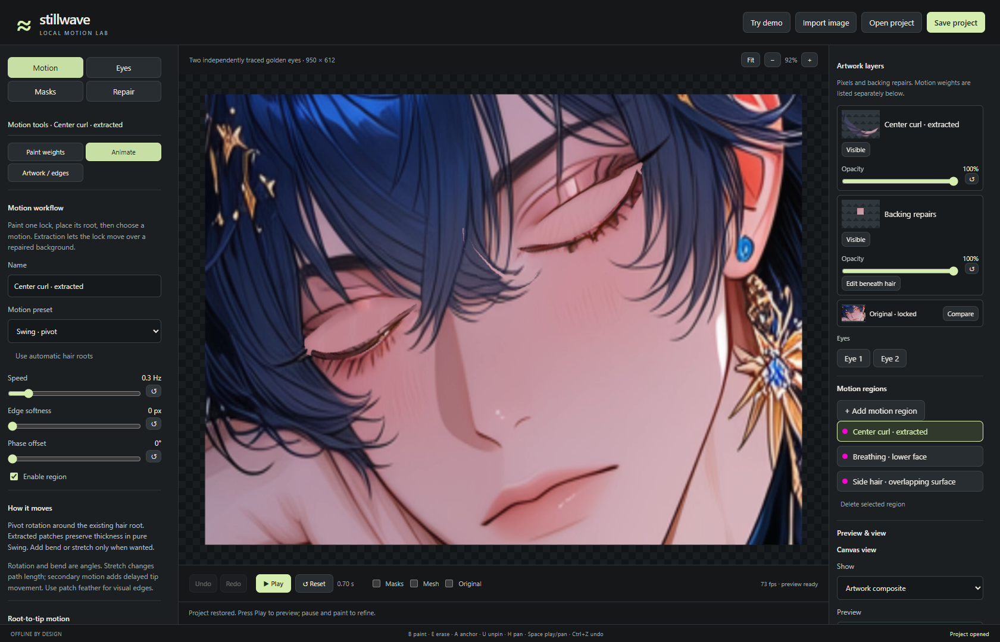
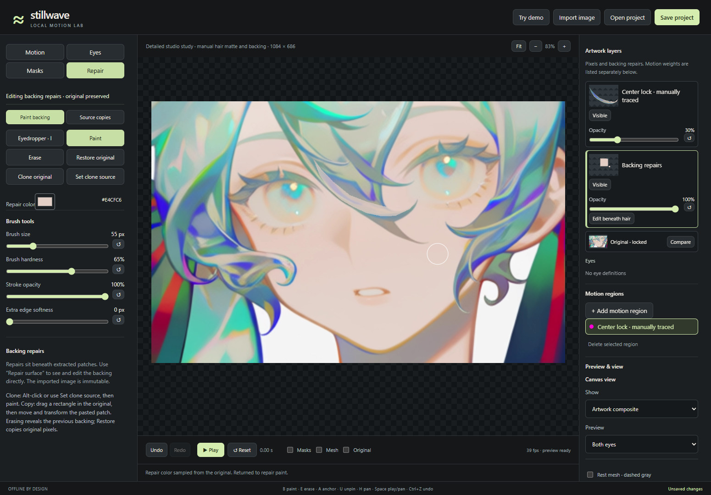
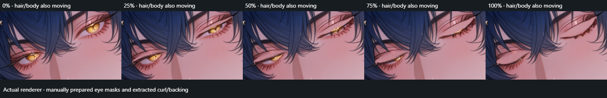

> Subsequent user recording exposed an additional layer-compositing bug: an extracted face/eye covered the base blink. It is now reproduced and fixed; see [EYE_LAYER_FIX.md](EYE_LAYER_FIX.md). This document records the preceding reliability pass.

# Stillwave refinement — reliability and painter-style workspace

## Launch and first test

Open `index.html` or double-click **Launch Stillwave.cmd** in the extracted Windows folder. Everything remains local. Existing version-1 and version-2 `.stillwave` files load; the original embedded illustration remains immutable.

Open **refinement-complex-study.stillwave** for a manually prepared extracted curl, backing repair, overlapping surface motion, and two independently configured eyes. Press **Play**. It uses the existing textured blink renderer and shared timing. The matte/backing are manual studies, not automatic extraction or hidden-background synthesis.

## Reproduced faults and fixes

| Fault | Actual cause | Change |
|---|---|---|
| Hair abruptly switches strength during normal playback | The old patch guard repeatedly halved all patch displacement after a triangle area crossed a threshold. Small time changes could switch between 100%, 50%, 25%, etc. | Calibrate a stable range for each patch over a complete cycle. Use a continuous compressive-strain bound as a safeguard, without quantized half-strength steps. Other locks retain their own range. |
| Jump immediately after time zero, especially delayed components | The path renderer returned the rest image only at exactly zero, although phase-delayed bend/tip terms were already nonzero an instant later. | An analytic 0.25-second start envelope joins rest continuously to the procedural motion. It is time-based, not a filter on previous rendered frames. Steady cycles remain periodic. Legacy phase-offset surface presets receive the same continuous start. |
| Guide-dependent displacement even near rest | The pose spine was interpolated across 64 samples, while offsets were measured from the exact polyline. Corners between samples used two different rest reference points. | Bind source offsets to the same sampled rest spine used by the animated frame. Pure unpinned Swing remains rigid. |
| Unnecessary limiting around apparently healthy artwork | Safety checks included transparent corners of the cropped rectangular mesh. | Only triangles touching visible source artwork participate in patch strain calibration. |
| First blink stalls partway through, especially on a newly opened project | Lash/skin preparation ran on the first closing frame while the clock was already advancing; the first frame also counted elapsed time from before Play. The older build reproduced roughly 150 ms of preparation inside the running blink. | Prepare eye assets and composition before starting the playback clock. Start the clock at zero after preparation, preserving the existing renderer. Preparation can still delay the start briefly. |
| A chosen eye closure changes unexpectedly when hair/body playback starts | Closure buttons claimed to return to manual preview, but the automatic clock immediately took ownership again on Play. | Explicit **Hold pose** and **Timed blink** preview modes. Closure buttons and the closure slider enter Hold pose. Hair/body playback can run without changing that closure. |
| Some single-eye studies do not blink on Play | Those projects deliberately stored automatic blinking disabled, but the control was hidden inside a collapsed timing section. | Keep the authored setting on load; show the current mode beside the closure controls. **Timed blink** enables the shared clock explicitly. |
| Timing changes with slow frames | Playback capped each elapsed frame at 60 ms, silently slowing time when drawing was slower. | Advance by actual elapsed time; pause when the browser tab becomes hidden instead of jumping forward on return. |
| Mask overlay reappears after undo while repairing beneath translucent hair | History restored the display choice, then the generic pause-for-edit routine overwrote it. | Restore the saved mask-visibility choice after pausing. Repair and opacity undo no longer unexpectedly obscure the backing with the motion overlay. |

This is not a replacement blink renderer. The older working checkpoint was tested with the same source projects at 0/25/50/75/100 closure. The shaded single-eye study matched exactly across all poses. The cel study differed in roughly 50–60 color channels across all five full images (maximum 19 levels); the two-eye study differed in 6–9 channels (maximum 1 level), with small GPU-run variation. These sparse edge differences do not establish a broad reconstruction regression. Existing protection, closure, iris-occlusion and crease tests still pass.

**Unverified:** a separate raster-corruption failure beyond the reproduced cold-start stall and preview-mode problem matching Rui's unspecified personal blink playback issue was not reproduced with the supplied studies. This pass fixes the reproducible cold-start and mode/timing problems; it does not claim that every possible project-specific blink failure has been identified.

## Revised workspace

**Left: editing tools and contextual settings.** Main workspaces are Motion, Eyes, Masks and Repair. Motion has **Paint weights / Animate / Artwork & edges** sections; Eyes has **Shape / Skin & masks / Copy & mirror / Timing**. Common brushes stay in the tool cabinet, and detailed controls appear for the selected task. Frequently used actions are buttons rather than long dropdown menus.

**Right: document structure and viewing.** Artwork rows have real source-derived thumbnails, names, selection, visibility and independent opacity. The backing is a distinct editing target and the original is marked locked. Motion regions appear separately, linked to extracted artwork through selection; they remain weights rather than pixel layers. Preview/isolation and mesh/display options are below the structure lists. There is no arbitrary parent-child rig hierarchy or full painting-layer graph.

### Repair underneath moving hair

1. Set the hair artwork row's **Opacity** to **30%** on the right. This does not change its source pixels, edge mask or motion weights.
2. Click **Edit beneath hair** on the **Backing repairs** row. The selected target stays visibly highlighted as backing.
3. Use **Paint**, **Erase**, **Restore original** or **Clone original** on the left. These tools edit only backing pixels, not the moving foreground texture. Switch to **Source copies** for copied rectangle transforms.
4. Click **Eyedropper · I**, or press I, and click the illustration. Sampling always reads the original image, applies no paint, and returns to the previous repair tool. Escape cancels sampling. The swatch and hex value show the selected color.
5. Restore hair opacity to **100%**, or use its individual reset. Check the composite while playing. Use **Repair surface only** to inspect the backing by itself.

Layer visibility/opacity are non-destructive preview controls stored with the project. The original remains unchanged. Backing visibility and opacity are independent of the foreground. An empty or unmatched backing still exposes holes or seams; transparency does not reconstruct hidden detail.

### Mask targets and exact meaning

| Current name | Older name | What it controls |
|---|---|---|
| Motion weight | Motion weights | How strongly the selected region deforms; does not extract artwork pixels. |
| Fixed pixels | Stationary anchors | Shared geometric pinning across motion regions. Use soft root attachments; a sharp pin at a moving tip can severely restrict that patch's safe range. |
| Artwork edge | Extracted patch matte | Which original pixels belong to the extracted layer, and the matching stationary-source hole. |
| Keep original | Patch protection | Pixels excluded from extraction, plus destination clipping of moving artwork over protected original details. |

These labels retain the existing stored keys and behavior. Select a target with the four visible buttons, read its short explanation, then paint/erase or use selection tools. Color/lasso selection still operates on original pixels; no semantic hair detection is implied. Eye-specific effect-limit, protection and lash masks remain in **Eyes → Skin/masks** with their existing roles.

### Eyes and playback

**Skin above** is first in the curve list and visible curve buttons. This changes order, not its underlying function. The selected eye is identified in the tool heading, eye selector and document list. **Delete selected eye…** asks for confirmation; one undo restores the definition and its painted masks. The other eye and shared blink settings remain intact.

Use **Hold pose** to inspect or edit any closure while hair and body move. Choose **Timed blink** for synchronized eye playback; detailed length/interval settings are in Timing. Copy/mirror controls and separate setting/mask-copy choices remain available. Selecting geometry or a mask does not silently convert or mirror the other eye.

### Mesh view

The previous display was a sparse grid of the connected base surface, omitting extracted artwork meshes and triangle diagonals. It already used current base positions, but did not clearly show what an extracted lock was doing.

**Mesh** now draws actual triangle edges for the selected extracted artwork, or the selected region of the base surface. It updates during animation. **Rest mesh** is dashed gray; **Animated mesh** is green. Root/rest-guide points and cyan fixed pixels can be shown separately. The overlay is off by default. Transparent crop padding is omitted. Guides describe source/rest geometry; the green triangles show the actual resulting motion, including anchor and safety constraints.

## Validation and actual renders

- Original eleven regression checks pass, including old/new project round trips, exact 0% eye appearance, textured lashes, upper-lid dominance, iris occlusion, protection/effect limits, crease follow, two-eye composition, source immutability, brushes and undo.
- Fifteen long-motion cases: Swing/Bend/Flutter, each with no anchors, soft roots, isolated tip pins, middle pins and outside-artwork pins. Each ran 30 simulated seconds at 60 samples/sec: **450 simulated seconds total**. Delayed tip and stretch were enabled in stress configurations.
- Tested visible-triangle areas remain above 10% of rest area; guard scale stays constant through each tested cycle. Loop comparisons after startup and arbitrary seek order return identical positions. Microsecond-sized time changes at the worst observed motion point produce no finite jumps.
- Overlap/independence checks remain in the studio regression: changing one extracted region's deformation does not scale a separate region. Complex playback includes extracted hair, overlapping body/hair surface regions and two eyes.
- Actual opacity rendering produces maximum alpha **255 at 100%** and **76 at 30%**, with unchanged source and matte. Opacity undo/redo and backing strokes preserve the foreground extraction.
- The current 9-second combined recording contains hundreds of actual browser frames, synchronized two-eye closures and both open and fully closed states. Tests also cover manual closure held during hair/body playback.

[Actual combined playback recording](test-output/refinement-combined-playback.webm)

Development checks: `node test-all.cjs`, `node test-refinement-workspace.cjs`, `node test-motion-continuity.cjs`, `node test-blink-reference.cjs`, `node test-cold-blink.cjs`, and `node test-refinement-visual.cjs`. The blink-reference check uses the extracted pre-studio checkpoint under `test-output/working-blink-reference`. Browser tests use the existing sibling Playwright installation. Detailed results are JSON in `test-output/refinement-*.json`.

## Remaining limitations and checkpoint

Hard/misplaced pins and aggressive bent or self-returning guides can require substantial motion attenuation for the affected patch. The Artwork section reports that limit; soften or move the fixed pixels rather than increasing strength blindly. Calibration is cached and may briefly cost time after a configuration change. Arbitrary self-intersecting guides, collisions and parent-child physics are not solved.

Extraction edge contamination, small matte fragments and imperfect underpainting remain artist cleanup tasks. Large pasted repairs may not match shading. This pass preserves those tools and improves access; it does not introduce semantic segmentation, automatic inpainting, a full painting app, animation export or user-defined presets.

Recoverable pre-change build: `_checkpoints/2026-11-10-pre-reliability-v2.zip`, with a SHA-256 manifest. Extract into a separate folder to run the previous build without overwriting current projects. The earlier pre-studio checkpoint is also retained.
