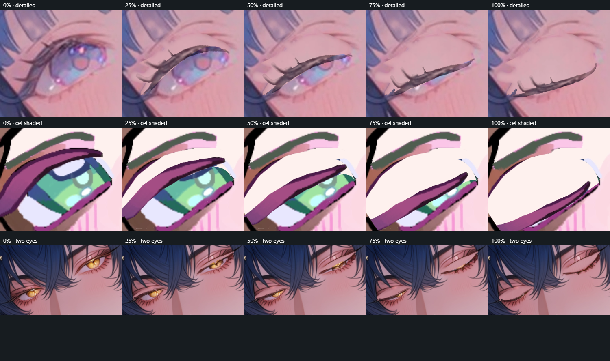
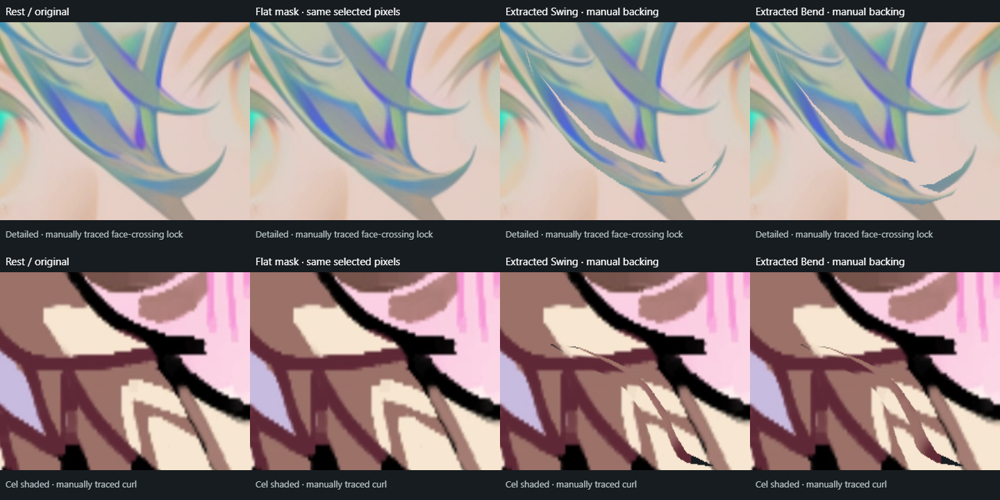

> The newer reliability/workspace pass supersedes panel placement and preview controls in this guide. See [RELIABILITY_PASS.md](RELIABILITY_PASS.md). The underlying extraction, repair and mask ownership described here is retained.

# Stillwave studio pass — using and evaluating this build

Double-click **Launch Stillwave.cmd**, or open **index.html** in current Chrome/Edge with WebGL enabled. No installation, build, account, cloud service, generative AI or network connection is required. Keep the complete extracted application folder together.

Try `studio-hair-study.stillwave` (shaded face-crossing lock), `studio-cel-study.stillwave` (cel-style curl and existing eye), and `blink-two-eye-study.stillwave` (two independently prepared eyes). The hair samples were **manually traced and repaired with copied original pixels**, not automatically segmented or reconstructed. Their exposed seams remain visible; they are working studies, not finished animation assets.

## What changed

| Area | Implemented | Practical limit |
|---|---|---|
| Eye curves | Optional multi-segment cubic paths; round nodes move in two dimensions; independent incoming/outgoing handles; add/remove points; independent crease endpoints; whole-eye positioning | Paths must stay ordered along the eye axis. Upper/lower curves cannot cross. This avoids folds but is not an unrestricted vector drawing tool. Up to 12 nodes per curve. |
| Blink preview | Always-visible closure slider and 0/25/50/75/100 buttons; painting retains the chosen pose; two-eye preview and existing timing retained | Choosing skin source/color temporarily shows the original. Curve guides describe source geometry; the pink dashed curve shows the moving lid. |
| Copy/mirror | Internal geometry clipboard; paste at target eye; adjustable vertical face centerline; mirror to other eye; separate settings/mask opt-ins | Geometry only by default. Repositioning an eye does not silently move its existing painted masks. A tilted face axis is not implemented. |
| Usability | Motion / Eyes / Masks / Repair workspaces; visible curve and target buttons; contextual settings; active-tool indication; tooltip descriptions; reset beside every slider | Native controls and scrolling panels remain; this is not a full UI redesign framework. |
| Brushes | Size, opacity, hardness and extra edge softness; interpolated strokes; erase; one undo per completed stroke | Repair backing is bounded to 2048 pixels on its longest side. Motion/extraction masks retain the existing 512-pixel limit. |
| Repair | Paint backing; erase; restore source pixels; clone from immutable original; source rectangle copies; move, scale, rotate, flip, opacity, feather and reorder copies; repair-only view | One backing paint surface plus up to 12 source-copy patches. No arbitrary painting layers, bucket-color painting, healing brush or content-aware synthesis. |
| Selection | Connected bucket, all matching color, edge-connected background, inverse background for simple subjects, lasso; add/subtract/replace/intersect; invert; manual Hair/Character/Background roles | No semantic hair/subject detection. Complex shaded backgrounds require manual tracing/refinement. Role combinations use the artist's existing masks. |
| Extraction | Optional transparent source-derived patch; independent matte and artwork protection; matching source holdout; backing repair; visibility and stack order | **Experimental.** Native alpha cannot be recovered perfectly from an opaque flattened image. Antialiased boundary contamination, source fragments and mismatched backing remain possible. |
| Hair | Real pivot Swing; progressive path Bend; delayed/higher-frequency Flutter; independent rotation, bend, stretch and tip motion; editable root-to-tip points; anchors; optional mask-weight blending | Path transport is procedural, not a physical hair simulation. Multiple locks are independent and inherit the base mesh's root frame; arbitrary parent-child rigs/collisions are deferred. |
| Reliability | Document history covers new geometry, masks, artwork, transforms and resets; v1 loader preserved; v2 for advanced assets; validation before replacing a document | History is memory bounded; save project files manually. There is no autosave. |

## Eyes: shape, preview and masks

Select **Eyes**, choose the eye and **Focus eye**. Use **Lash**, **Landing**, **Crease**, **Skin above** or **Skin below**. **Bézier handles** converts only that curve, preserving its old shape. Round nodes move freely in both dimensions within ordering constraints; square handles shape the adjacent segments independently. **Add point** splits at the clicked eye-axis position, then switch back to **Bézier handles** to drag it. **Remove point** removes a selected interior node. Endpoints of the crease and skin-support curves are independent; eyelid corners remain shared. Arrow keys nudge the selected handle; Shift increases the step.

The yellow lash curve carries the original textured lashes downward. The green lower curve is the landing target and remains stationary by default. Orange is the crease; **Crease follow** moves it a fraction of the upper-lid travel, tapering within **Crease reach**. Blue dotted supports define the source skin sampling extent. Supports do **not** clip every effect.

The old “Blink edit area” is now **Blink effect limit**. Inspection confirmed that it clips the final blink modifier, including skin, lashes and crease. Paint it blue where changes are allowed; erase outside the intended area. **Protect** hatches artwork that remains original even inside the effect limit. Do not protect the iris, or it will remain visible at full closure. These are distinct from **Lashes**, which selects original pixels that travel with the upper lid, and **Skin touch-up**, which adds local repair under those lashes.

Hold any closure while painting. Lash painting maps the brush back through the lid's tangent-frame deformation into original source texture coordinates; its overlay follows the posed lashes. Skin touch-up maps through the subtle crease warp. Effect limit and protection paint directly in final artwork coordinates, because these boundaries are stationary. Very large brushes across sharply changing curvature or extreme lash roll use a local inverse approximation; refine with smaller strokes. Original appearance at 0% is still exact.

**Copy geometry** stores the selected eye internally. Select the other eye and **Paste at selected eye** to keep its location, or use **Set face centerline** and click the face, then **Mirror to other eye**. A second eye is created if needed. Settings and painted masks have separate unchecked opt-ins; masks are never implicitly mirrored. Confirm placement manually on asymmetrical artwork. Mirror is one undoable action.

## Hair: simple first, extract when useful

For the existing easy workflow, paint a motion region, choose a preset and Play. Anchors remain shared stationary areas. Existing projects and all four old presets keep their previous behavior.

**Swing** rotates around the hair root. With bend, stretch and secondary motion at zero, a free extracted patch undergoes a rigid pivot rotation and retains strand thickness. **Bend** progressively rotates a root-to-tip spine; **Flutter** adds faster delayed tip motion. Components are separate sliders instead of aliases for translating the same image. These methods can also drive flat masks, though a connected flattened surface still has to stretch to accommodate movement.

Choose **Edit path**, drag its root and tip, and add intermediate points if needed. Root point and the existing **Hair root** tool remain connected. **Automatic path** returns to a path inferred from the root and farthest painted vertex. Use blue anchors across attachment areas, small rotations and modest tip motion. Excessive curvature/stretch can still distort a patch. Safety correction affects that patch alone, not every other region.

For independently moving pixels:

1. Paint a clean motion region over one complete lock, including its original outline.
2. Click **Extract current motion mask**. This snapshots a separate visual matte and switches to Swing. The motion mask remains available independently.
3. In **Masks**, choose **Extracted patch matte** and Paint/Erase to refine it. Choose **Patch protection** to exclude stationary hair, linework or facial details. This protection also clips the patch where it crosses protected destination artwork.
4. The original patch is removed below it, preventing a stationary duplicate. Empty hidden areas remain empty until you repair them. In **Repair**, use backing paint, clone or source-copy patches to fill the revealed area. **Repair surface only** isolates that backing.
5. Tune path, anchors and motion, then inspect both extremes. Adjust **Stack order** for overlapping extracted locks; higher numbers draw in front. Visibility hides the moving artwork but keeps its source hole, exposing the backing.

Hard edges prioritize original rest reconstruction. Optional feathering fades inward, so it cannot enlarge the selected source boundary. Feathered borders require backing even at rest and can reveal texture/color mismatches. Source alpha and colors are preserved, but a flattened opaque edge may already contain blended background colors; there is no automatic unmatting. Extraction is best treated as an artist-prepared option for movements that flat masks cannot handle cleanly.

## Repair and selection workflows

Repairs are composited **under source holdouts**, never painted destructively into the original. In the normal scene, backing outside holes is hidden. Use the repair-only view to see the complete backing. **Clone original** samples original pixels; Alt-click or **Set clone source** chooses its source, then paint a destination stroke. Each stroke keeps its source offset. **Restore original** copies the source at matching coordinates, useful for correcting an over-erased backing. Erase removes paint, revealing earlier copied patches/backing.

**Copy source rectangle** temporarily shows the original. Drag a rectangle, then use **Move pasted patch** and its transform sliders. Copies retain a reference to the original source rectangle rather than baking resampled pixels after every move. Patches can be mirrored, feathered, reordered or deleted independently. They form the backing below the paint surface. Brush strokes can then refine them.

The bucket selects colors from the original at mask resolution, with a soft tolerance band for edge coverage. **Background from edges** selects only matching pixels connected to an image edge; click a representative background color. **Subject from edges** inverts that selection, which works best with simple flat backgrounds. **Matching color** ignores connectivity. Lasso uses clicks, Enter to apply and Escape to cancel. Add/subtract/replace/intersect work on the active target. Manually label existing regions as Hair or Background before using role-based keep/exclude/protect actions. These labels do not invoke detection.

## Architecture and compatibility

The original embedded image and original GPU texture remain immutable. The default shared mesh is retained. Optional `artwork.js` prepares a cached source holdout/backing composite and draws cropped source-derived cutout meshes afterward. Blink patches still compose on the base image before the connected surface; extracted hair can draw in front of eyes. Arbitrary interleaving of eye patches, cutouts and imported layers is outside this pass.

| Owner | Stored data / responsibility |
|---|---|
| `app.js` | Document, history, v1/v2 validation, masks and project save/reopen |
| `curve-paths.js`, `blink.js` | Optional ordered cubic paths; GPU curve lookup; old analytic cubics remain unchanged when no paths exist |
| `eye-tools.js` | Held-pose editing and source/posed brush mapping |
| `studio-core.js`, `studio-ui.js` | Shared brush/selection utilities, task tools, non-destructive edit transactions |
| `hair-motion.js` | Original root-to-tip transport with rotational frames |
| `artwork.js` | Backing paint/source-copy patches, extracted mattes, source holdouts, visual order and per-patch safety |

Visual matte determines **which original pixels belong to a patch**. Motion weights optionally determine **how strongly its vertices move**. Anchors hold geometry still. Protection excludes artwork from modification. Backing paint/copies provide hidden pixels. Each has one explicit role; they are not secretly linked copies of one mask.

The loader accepts existing version-1 projects without upgrading their rendered behavior. Advanced path/artwork documents save as **version 2**, deliberately preventing older Stillwave builds from silently discarding new assets. Mask dimensions, geometry and transforms are checked before replacing the current document. Original image, old eye records, timing, display colors and prior motion settings are preserved.

A pre-change recovery archive and SHA-256 manifest are in `_checkpoints/2026-11-10-pre-studio-v1.*`. Extract it into a **separate folder** to run the previous build. The current Windows zip is a separate deliverable.

## Actual renders and validation

These blink studies use previously manually refined lash selections, repair limits, skin samples and protection. The new multi-segment crease representation is exercised without pretending the asset preparation was automatic. Existing detailed and cel checks still report exact original pixels at 0%, no protected/outside-limit changes and no sampled iris remaining at full closure.

The hair comparison uses manually traced mattes and copied backing pixels. The shaded lock moves independently of the face, but its cut boundary and copied skin remain visible. The cel curl also has visible matte/backing discontinuities. Those results are **not professional-ready**; tighter mattes, anchored attachment edges and matched underpainting are still needed. The engine now provides the separate controls and repair ownership for that work instead of stretching nearby face pixels to hide the gap.

[Actual four-second Swing preview](test-output/studio-swing-preview.webm)

The detailed extracted rest study differed by at most one channel level in an early capture and was pixel-identical in the final capture. At motion time, 9,690 pixels changed inside the tested local region, with zero changed pixels outside its bounding area. Pure Swing held the root exactly and preserved tested cross-section distance within floating-point error. This is evidence for the implementation on the fixture, not a guarantee for arbitrary painted mattes or extreme settings.

Run `node test-all.cjs` for the complete regression suite using the sibling local Playwright development installation. Validation logs and JSON are in `test-output`. Checks cover old/new round trips; two independently configured eyes; five closures; projection-aligned painting (0.006 px centroid error in the tested 75% lash stroke); curve nodes/endpoints and undo; explicit mask mirroring; reset isolation; color selection; clone/erase/copy/move undo; empty mattes; independent patch motion; positive triangle areas in both actual hair studies; and browser errors. Chrome preview performance is hardware-dependent; dense artwork preparation may pause briefly on the first edit.

Deferred: semantic detection, automatic hidden-background reconstruction, arbitrary layer hierarchies/PSD, collision/physics rigs, tilted face mirroring, animation curves/timeline, expression management and high-quality export. No proprietary PrettyUp assets, private services or code were used. The recordings were behavior references only and do not establish PrettyUp's internal algorithms. Research decisions and links are in `STUDIO_PASS_PLAN.md`.
