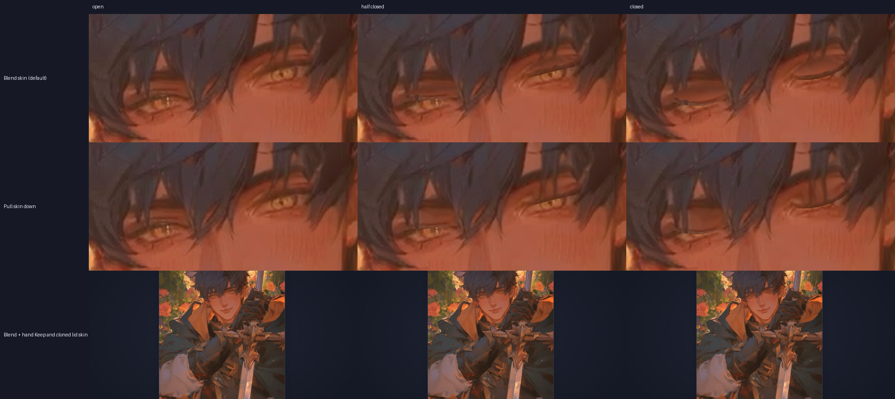
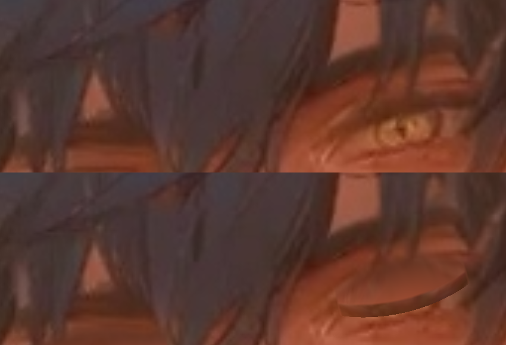
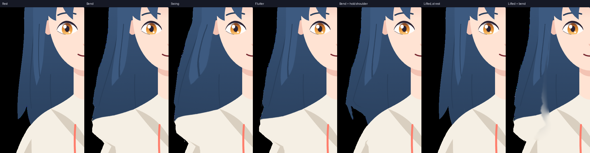
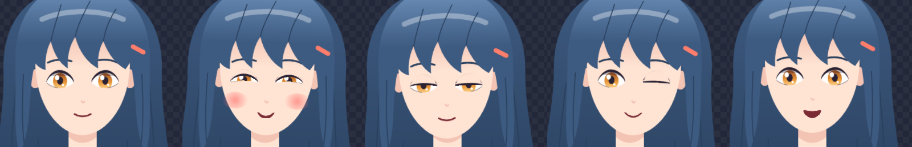
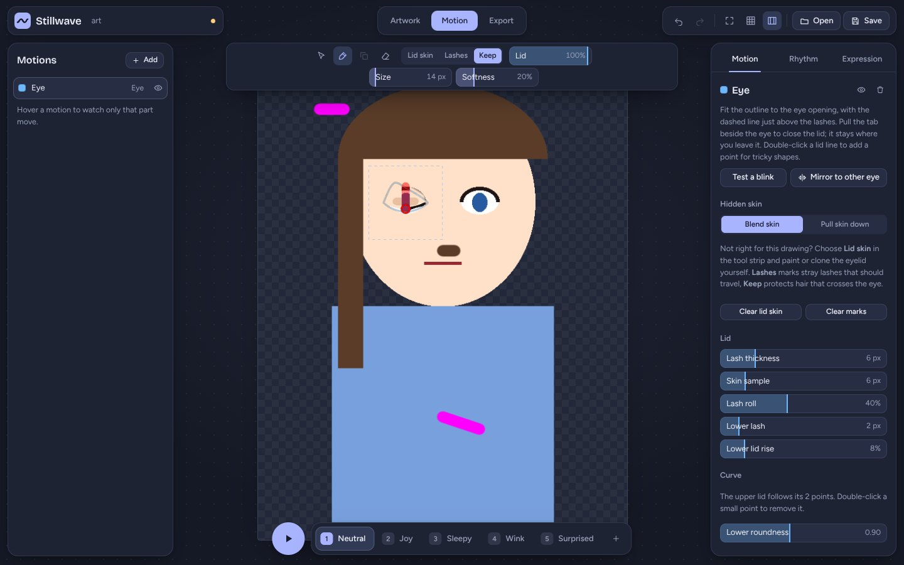
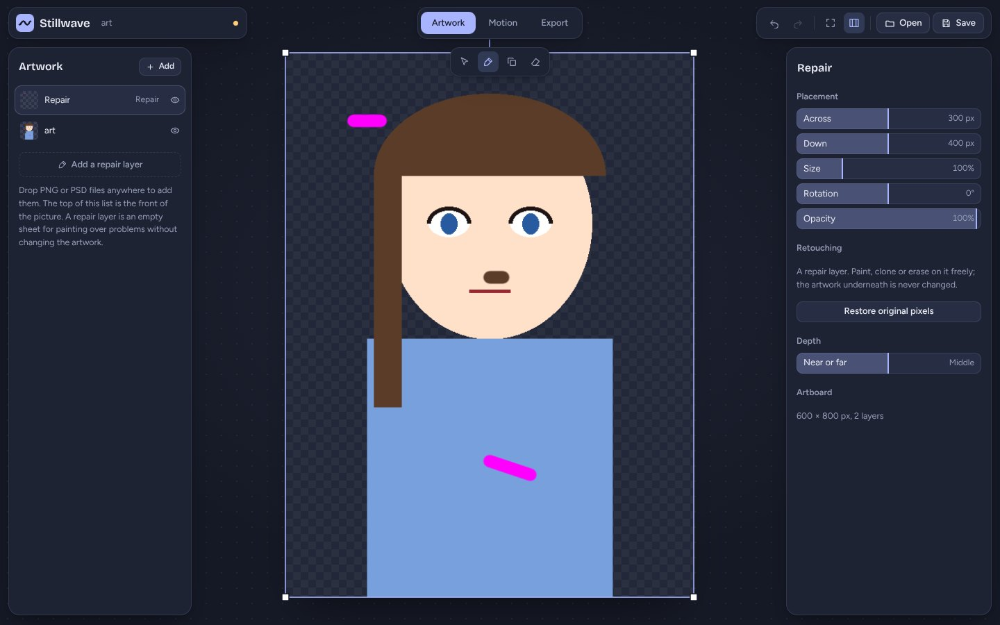
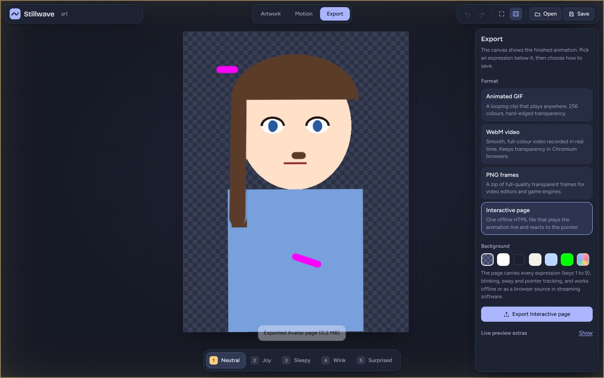

# What I learned from the reference Stillwave

The reference is the `boom-boom` branch of this repository: a long-iterated,
dependency-free vanilla JS editor. I read it as a read-only copy outside this
project and did not copy its code. This document compares the two approaches,
lists what I adopted and why, and shows rendered results.

Checkpoint of my implementation before this pass: git tag `checkpoint/v1-independent`
(commit `d0dfaf3`).

## How the two differ underneath

| | Reference Stillwave | This implementation |
| --- | --- | --- |
| Stack | Vanilla JS, one shared WebGL1 triangle grid (144 cells on the long side) over one flat image | React + TypeScript + Vite; WebGL2; one grid per layer, so PSD layers move independently |
| Motion source | Pure functions of time (sine waves with phase lag) | Spring physics with history: hair lags and overshoots head movement, a click "nudges" |
| Hair | Path transport: rigid frames carried along a root-to-tip path; Swing / Bend / Flutter as distinct formulas | Now: the same transport idea, driven by my springs, with paint weight scaling the angle |
| Overlaps | Squared-weight partition of unity; global anchors; 12-pass edge projection plus island fallback | Squared-weight partition; hold-still paint; a lighter fold guard |
| Blink | Separate render-to-texture pass per eye (max 2): skin plate built on the CPU, lash matte transported with a tangent-frame inverse, crease warp, protect/limit masks, multi-segment Bézier curves | One shader pass in rest space for up to 8 eyes; lash band slid down; skin blend or stretch; per-eye paint for lid skin, extra lashes and keep marks; monotone lid splines through added points |
| Repair | Backing paint under source holdouts; clone from the immutable original; movable source-copy patches; flood/lasso selection | Any layer is retouchable (brush, clone, eraser; Over / Behind / Inside) with its original kept; empty repair layers; lift with an automatic pull-push fill behind |
| Extraction | Manual matte, empty hole until the artist repaints it | Lift cuts on the brush falloff midpoint and fills the hole automatically, so it is usable immediately |
| Output | Project file only (no GIF or video export) | GIF, WebM, PNG frames, offline interactive page |
| Persistence | Manual save; v1/v2 file versions | Manual save plus browser autosave; old files upgraded on open |

## What the reference does better

- **The blink is more anatomical.** Upper-lid-led closure with a stationary lower
  lid, a crease that follows the lid, and lash pixels transported with their exact
  shape (including tips and roll) through a tangent frame. My lash band slides
  well, but tips that stick out past the band need the Lashes brush.
- **Fine curve control.** Multi-segment Bézier lids with independent handles and a
  separate crease curve. My shaping points are easier to place, but there are no
  tangent handles and no crease.
- **A stronger strain solver.** Twelve projection passes plus island-limited
  fallback keep extreme poses from folding. My guard is simpler.
- **Selection tools** (bucket, edge-connected background, lasso, add/subtract).
  I did not build these.
- **Test discipline.** Exact pixel checks at rest, projection error in pixels,
  positive triangle areas. I adopted that habit (see the lift check below).

## What this implementation already did better

- **Real secondary motion.** Springs give hair lag, overshoot and settle; the
  reference replays fixed sine curves that never react to the head.
- **Layers.** A PSD's layers move as separate pieces with their own meshes and
  depth parallax; the reference is built around one flattened image.
- **Direct manipulation.** Pulling the lid by hand, painting root-to-tip to set the
  sway direction, hover-to-preview, and grab-anywhere sliders are faster to learn
  than the reference's dense button panels.
- **Export.** The reference has none.
- **Cost of the eye effect.** One shader pass, no per-eye framebuffers, no CPU
  plate rebuild when a closure value changes.

## The strongest ideas I adopted

1. **Upper lid does the work.** The old "closing line" became **Lower lid rise**
   (default 8%; 0% keeps the lower lid still). This one change makes blinks read
   as blinks rather than two shutters meeting.
2. **Every mask has one job.** Motion paint, **Hold still**, the eye's **Keep** and
   **Lashes** marks, **Lid skin** paint, and a lifted layer's **backing** are
   separate things, never one mask doing two jobs.
3. **Choice of skin reconstruction.** **Blend skin** (new default) or **Pull skin
   down** (the first build's method), with hand paint and clone on top.
4. **Hair as transport along a spine, with distinct styles.** Swing, Bend and
   Flutter are different motions, not one slider. I kept my springs as the
   driver and added one change of my own: paint weight scales the angle a point
   receives instead of blending positions.
5. **Non-destructive repair.** Originals are never overwritten; repairs live on
   their own layers; clone samples the artwork at rest.
6. **Squared-weight blending for overlaps.**

## Where I deliberately did not follow it

- **No CPU skin plates or per-eye framebuffers.** The shader approach scales to
  more eyes, follows mesh motion for free and costs nothing when closure changes.
- **No sine-driven hair.** Springs stay; the transport only changes how a turn is
  applied, not what drives it.
- **No global "protect" for edits.** Retouching happens on separate layers or on
  the eye's own paint, which protects the artwork by construction.
- **No empty holes after extraction.** Lift fills the hole with a guess at once,
  and the guess is exactly hidden at rest.

## Rendered results

All renders come from the app's own renderer via the scripts in `tests/`.

**Blink on a real, painterly illustration** (the reference repo's `demo.jpg`,
used read-only):

- *Blend skin* (top row) keeps the dark fringe out of the lid; *Pull skin down*
  (middle row) drags the shadowed skin under the fringe into the lid, which is
  why Blend is now the default.
- The bottom row adds two Keep strokes over the hair crossing the left eye and
  two cloned lid-skin strokes. The hair stays put over the closed lid.
- Zoomed in, the automatic fill is still visibly a patch (below). At normal size
  the closed eyes read as closed eyes.

**Hair at one fixed, strong pose** (flattened sample, tip turned 0.5 rad):

Mesh stretch inside the strand (average and worst change in grid-edge length,
mask weight above 0.5; lower means the strand keeps its drawn shape better):

| Method | Average | Worst |
| --- | --- | --- |
| First build: rotate each point about the root | 26.2% | 4.56× |
| Bend: carried along the spine (now) | 19.7% | 2.29× |
| Flutter | 20.0% | 2.45× |
| Swing: rigid turn | 28.2% | 2.48× |

- Bend roughly halves the worst-case stretch.
- Swing is rigid inside the lock, but on flat art all of its movement has to be
  absorbed by the soft border, so it measures worse. The UI now says so, and
  recommends Swing for lifted pieces.
- *Bend + hold shoulder* shows the trade-off of anchors: the shoulder no longer
  hooks, but the hair tip over it shears.
- *Lifted, at rest* differs from the original in 1,330 of 156,000 pixels (all on
  antialiased edges). Before I fixed the matte it was 7,881 pixels with visible
  streaks, which the earlier version of this test caught.
- *Lifted + bend* shows the honest limit: the guessed backing on the hoodie is a
  smudge an artist would repaint on the backing layer.

**Expressions on the layered sample:**

**The new tools in the interface:**

## Where both still fall short

- Neither knows what is actually behind an occluding shape. Both guess (mine
  automatically, the reference from the artist), and on detailed art the
  artist still has to paint it.
- Blinks on painterly art need hand refinement in both to hold up when zoomed in.
- Both need eyes fitted by hand. Automatic lash-line snapping would help casual
  users most; it is the first thing I would build next.
- Neither has a keyframe timeline; motion is procedural.
- Anti-aliased edges from a flattened image carry background colour into
  lifted/extracted pieces in both; neither unmixes them.
